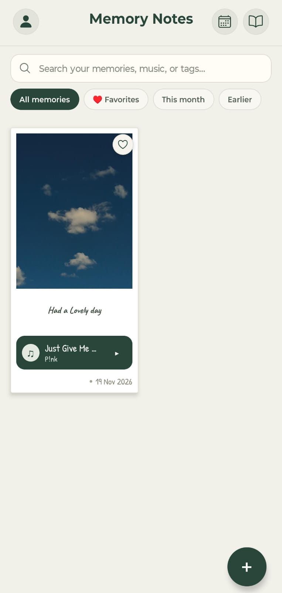
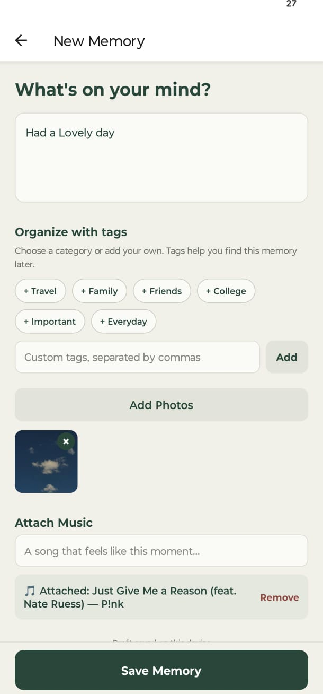
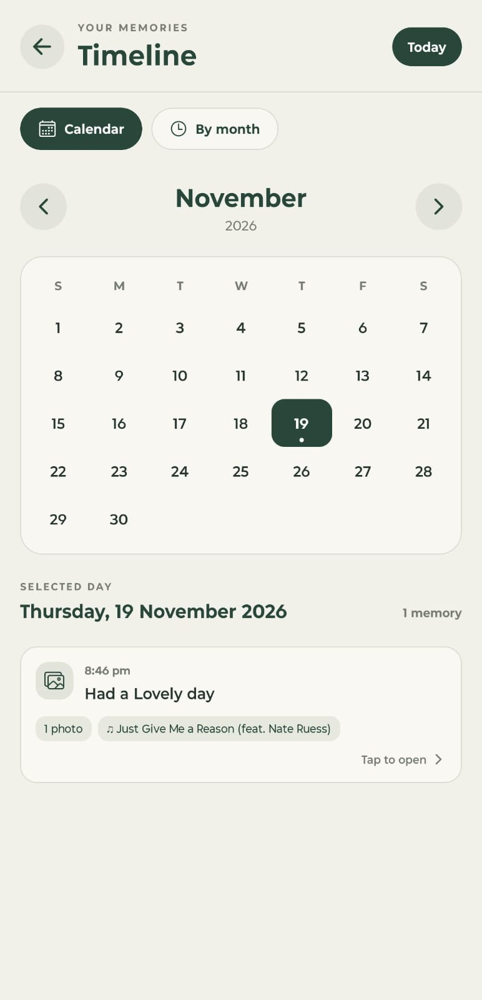
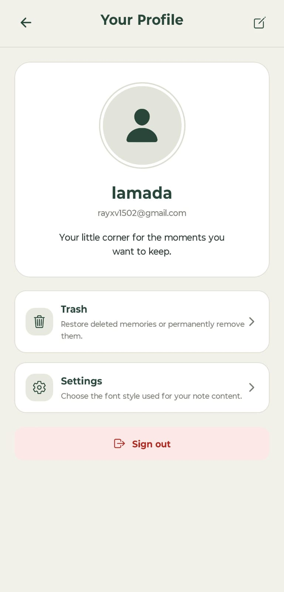

# 🌿 Memory Notes

### Keep the moments that matter close.

Memory Notes is a personal journaling and memory-sharing mobile application built with **React Native, Expo and Supabase**.

It gives users a dedicated space to preserve meaningful moments through personal notes, photographs, audio and shared journals. Users can also invite friends to contribute to group journals and create memories together.

---

## 📱 About the Project

Memories are more than photographs. They are experiences, stories and moments that deserve to be remembered.

Memory Notes aims to make preserving those moments simple and meaningful. Whether you're documenting your everyday life or creating a shared journal with friends, Memory Notes brings your memories together in one place.

---

## ✨ Features

### 📝 Personal Journals
- Create and manage personal memories.
- Write notes about everyday experiences.
- Edit and delete journal entries.
- Organize and revisit saved memories.

### 📸 Photo Memories
- Attach photographs to journal entries.
- Upload and view saved images.
- Preserve visual moments alongside written memories.

### 👥 Group Journals
- Create shared journals with friends.
- Invite other registered users.
- Accept or decline journal invitations.
- Allow group members to contribute memories.
- View memories shared by other members.

### 🔔 Push Notifications
- Receive group journal invitation notifications.
- Get notified when new group memories are shared.
- Navigate to the relevant group journal from notifications.

### 🎵 Music and Audio
- Add an audio dimension to personal memories.
- Make journal entries more expressive.

### 🔐 Authentication
- User registration and sign-in.
- Account-based access to personal journals.
- Password visibility controls.

---

## 🛠️ Tech Stack

| Technology | Purpose |
|---|---|
| React Native | Mobile application development |
| Expo | Development and native builds |
| TypeScript | Application programming |
| Supabase | Backend and authentication |
| PostgreSQL | Database |
| Supabase Storage | Image and media storage |
| Supabase Edge Functions | Backend notification workflows |
| Expo Notifications | Push notification integration |

---

## 🖼️ Screenshots

Screenshots will be added here as the project develops.

<!-- Add your screenshots below -->

### Home Screen


### Create Memory


### Memory Timeline


### Profile


### Login Screen

---

## 🚀 Getting Started

Follow these instructions to run Memory Notes locally.

### Prerequisites

Make sure you have installed:

- [Node.js](https://nodejs.org/)
- [Git](https://git-scm.com/)
- [Expo CLI / Expo tooling](https://docs.expo.dev/)
- [Visual Studio Code](https://code.visualstudio.com/)

### 1. Clone the repository

```bash
git clone https://github.com/Kunsang-la/Memory-Notes.git
```

### 2. Navigate into the project

```bash
cd Memory-Notes
```

### 3. Install dependencies

```bash
npm install
```

### 4. Configure Supabase

Create a Supabase project and configure the required project URL and client key in the application's Supabase configuration.

The application uses Supabase for authentication, database operations and storage.

Make sure the required database tables, storage buckets, Row Level Security policies and backend functions are configured before running the complete application.

### 5. Start the development server

```bash
npx expo start
```

For a development build:

```bash
npx expo start --dev-client
```

---

## 🔔 Push Notification Configuration

Memory Notes uses Expo Notifications and a Supabase Edge Function for group-related notifications.

The notification integration requires:

- Firebase Cloud Messaging configuration for Android.
- Expo project configuration.
- Supabase Edge Function deployment.
- Appropriate push notification credentials.

**Note:** Private credentials and service-account files should never be committed to the public repository.

---

## 🔒 Security

Memory Notes uses account authentication and backend access controls.

Anyone deploying their own instance should:

- Configure Supabase Row Level Security.
- Protect private user memories.
- Restrict group journal access to authorized members.
- Keep service-role keys and private credentials secure.
- Configure appropriate storage access policies.

---

## 🗺️ Future Development

Some areas planned for further development include:

- iOS application support.
- Improved account and password management.
- Additional journal customization.
- Better notification controls.
- Further performance and UI improvements.
- More ways to organize and revisit memories.

---

## 🤝 Contributing

Contributions, suggestions and feedback are welcome!

If you find a bug or have an idea for improving Memory Notes:

1. Fork the repository.
2. Create a new feature branch.
3. Make your changes.
4. Submit a pull request.

For significant changes, please open an issue first to discuss your proposal.

---

## 👨‍💻 Developer

**Kunsang Lama**

GitHub: [@Kunsang-la](https://github.com/Kunsang-la)

---

## 📄 License

A license has not yet been specified for this project.

---

<p align="center">

**Memory Notes 🌿**

*Keep the moments that matter close.*

</p>